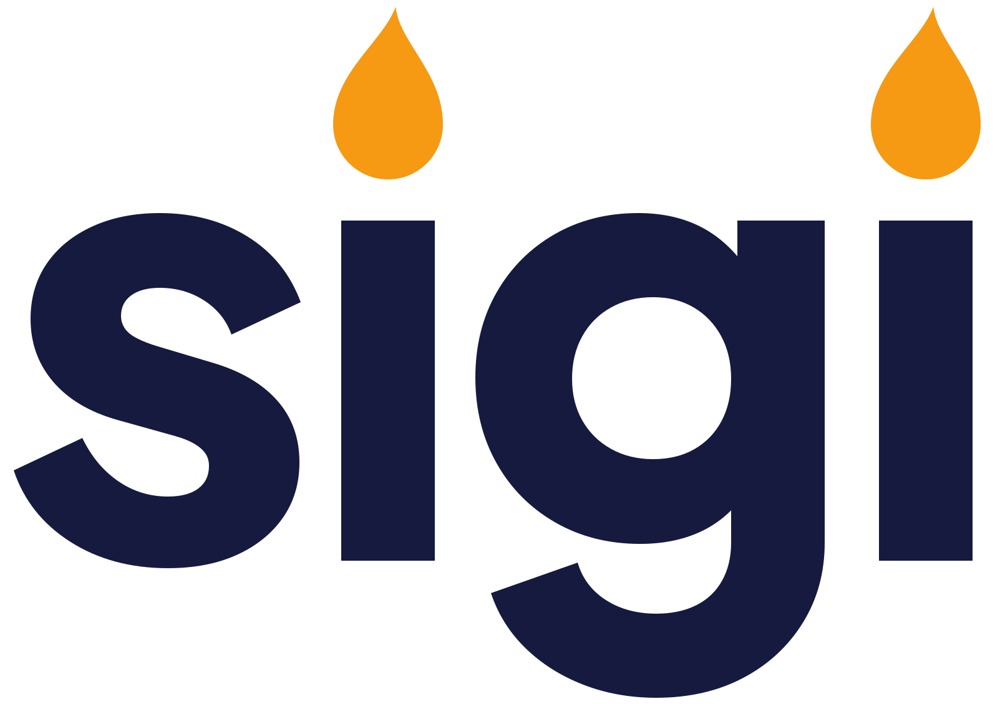

<h1>
  <picture>
    <source media="(prefers-color-scheme: dark)" srcset="docs/brand/wordmark-dark.svg">
    
  </picture>
</h1>

A research site for Indonesian listed companies. It covers who owns each company and what changed this month, how much of it really floats against the new 15% rule, how macro conditions move each sector, investment theses with explicit invalidation conditions, and a daily AI brief that cites its evidence. It uses only free data, and every figure shows its source.

*Sigi* is a torch; *menyigi* means "to light up" and "to investigate carefully" (KBBI).

**Status:** phase P1, started 2026-10-22, live and open to search engines since 2026-10-26 (D-028) at https://sigi.ubaidillah.id.

- **M1** (deployed 2026-10-23): the monthly >1% holders import with validation gates and fail-closed publishing (PRD F1), data health and sources (F10), ownership per company (F2), and the Dokploy deployment.
- **M2** (deployed 2026-10-23): the investability tracker against the 15% free-float rule (F3), the holder explorer for institutions (F4), and the market page with the ownership screen and TradingView widgets (F9).
- **Automation** (2026-10-24): a worker fetches the monthly files from the exchange's site and imports them; there is no admin, upload or sign-in (D-021).
- **M3** (deployed 2026-10-24): the macro dashboard (F6) at `/macro`, fed daily from Bank Indonesia, the World Bank Pink Sheet, FRED and, since D-029, the Bank for International Settlements; 16 series in three groups.
- **M4** (deployed 2026-10-25): theses (F7) at `/theses`, files in `theses/` with typed invalidation conditions that the worker checks daily (D-024).
- **M5** (deployed 2026-10-25): the daily brief (F12) at `/brief`: an agent reads Sigi's own readings each morning and writes one file that the page validates before showing (D-025).
- **M6** (deployed 2026-10-25): the company page with its dates and TradingView sections (F8), English and Indonesian on every page (F11, D-026), Playwright and Lighthouse checks in CI.
- **Redesign** (2026-10-26, D-027): a new identity (the `sigi` wordmark with a flame on each i, the torch, nila indigo and obor amber, Plus Jakarta Sans and Newsreader) and one design system under every page; the register carries an ownership bar per company, with the free float lit and the 15% minimum marked.
- **Launch** (2026-10-26, D-028): three theses published (`theses/`: BRIS and CIMB Niaga float steps, coal and the rupiah) and the `X-Robots-Tag: noindex, nofollow` line removed from the site's nginx server block. To take the site out of search engines again, put that header back and reload nginx.
- **After launch** (2026-10-27, D-029): five or more macro series in every group, the repository made public, a trademark search in the WIPO Global Brand Database, and an IndexNow submission of the sitemap to Bing and the other IndexNow engines. Google Search Console and Bing Webmaster Tools need the owner's sign-in and are not done.
- **Discovery** (2026-10-27, D-030): each page has its own description and canonical address, company and thesis pages carry structured data, and `/llms.txt` maps the site for AI assistants.

| Doc | Purpose |
|---|---|
| [docs/DESIGN.md](docs/DESIGN.md) | The identity (wordmark, nila and obor, the lit ownership bar), tokens, shared parts and the rules for using them |
| [docs/PRD.md](docs/PRD.md) | What we build, for whom, under which constraints; features with acceptance criteria; phases; risks |
| [docs/DATA-SOURCES.md](docs/DATA-SOURCES.md) | Register of every data source: terms, quotes, status, attribution, known issues |
| [docs/DECISIONS.md](docs/DECISIONS.md) | Decisions and their consequences |
| [docs/ARCHITECTURE.md](docs/ARCHITECTURE.md) | System shape, import pipeline, the copy manifest and log from Sunrise, the daily brief pipeline, pages, tests |

## Run it locally

Node 24, pnpm 10, and Google Chrome for the worker.

```sh
pnpm install
cp .env.example .env            # on macOS, set SIGI_CHROME_PATH to Chrome's binary
node --env-file=.env --import tsx scripts/migrate.ts
node --env-file=.env --import tsx scripts/worker.ts --once   # check every feed once; or name feeds, e.g. --once fred-DGS10
pnpm dev                        # http://127.0.0.1:3220
```

The worker opens the exchange's [share-ownership data page](https://www.idx.co.id/id/perusahaan-tercatat/data-kepemilikan-saham/) in a real Chrome, lists the monthly files *Pemegang Saham di Atas 1%*, and downloads and imports each one it has not imported yet, oldest first. It also checks the macro feeds over plain HTTP: four Bank Indonesia tables, the World Bank's monthly commodity workbook and three FRED series (D-023). Without `--once` it repeats every `SIGI_FETCH_INTERVAL_HOURS` (24 by default) per feed. Each file gets one of three outcomes, all shown on `/data`:

- **published**, when no check fails; warnings (a few source rows whose shares do not add up, an unrecognised investor type, a big move in an issuer's holder count) are published with the file and listed;
- **rejected**, with the reasons; the previous month stays live;
- **no-op**, when the same file, or the same figures in new bytes, were imported before.

The exchange's terms ask that its site not be scraped, and Bank Indonesia publishes no terms. Sigi fetches from both automatically anyway, by the owner's decision; DECISIONS D-021 and D-023 record the risk.

`pnpm verify` runs format, lint, types, tests and a production build. The tests include the rebuild check on synthetic files. To also test against the real files, set `SIGI_S1_REAL_DIR` to a directory holding `one-YYYY-MM-DD.xlsx` files. Real files are never committed, because they name individuals.

`pnpm rebuild:check` re-derives every published S1 month and macro series from its stored source file and compares content hashes.

## End-to-end tests

Playwright drives every public page in Chromium, and Lighthouse audits each page's accessibility (PRD §10). Neither is part of `pnpm verify`; CI runs them in the separate `e2e` job.

```sh
pnpm exec playwright install chromium   # once
pnpm e2e                                # builds, seeds, serves, runs the specs
pnpm lighthouse                         # the same site; accessibility score of at least 90 on every page
E2E_SKIP_BUILD=1 pnpm e2e               # reuse the existing .next build
```

Each run seeds a synthetic database and thesis and brief files into a temporary directory (`e2e/seed.ts`, nothing from `~/sigi-local`) and serves the production build on port 3231, with a second, empty site on 3232 for the "nothing yet" states. TradingView requests are answered locally, so nothing needs the network. The directories are removed afterwards; `E2E_KEEP=1` keeps them. Lighthouse runs every page in English and Indonesian, in the light and dark schemes, at desktop and phone size, and writes `lighthouse-report/accessibility.md` and `.json`; the Playwright report is in `playwright-report/`.

## Writing a thesis

A thesis is `theses/<slug>/<YYYY-MM-DD>.md`, where the slug is lower-case words joined by hyphens. Each new version is a new file dated the day it was written. Older files stay as they are, and the page shows what changed. Commit and deploy to publish. The file starts with two fenced blocks, then the prose:

````markdown
```thesis
title: One line, up to 120 characters
tickers: BBRI, BBNI
stance: A description of the view, up to 160 characters
summary: The thesis in one line
status: active
review: 2027-01-31
catalyst: 2027-03-31 First free-float deadline for large caps
```

```conditions
ownership BBRI "PT HOLDER NAME" below 50%
float BBTN below 12.5% from 2027-03-31
macro bi-rate above 6.25
date 2027-06-30 no placement by then
price BBRI below 3500
```

## Why
…
````

- **Header:** status is `active`, `invalidated` or `closed`; `catalyst` may repeat. The stance describes the view: ratings, targets and a sentence opening with buy, sell or hold are refused.
- **Conditions:** `ownership` names an institution as the register spells it and compares its position; `float` compares the free-float upper bound and takes only `below`, optionally from a date; `macro` takes a series id (`bi-rate`, `cpi-yoy`, `jisdor`, `fx-reserves`, `reer-idr`, `brent`, `coal`, `palm-oil`, `nickel`, `tin`, `gold`, `fed-funds`, `us-10y`, `usd-broad`, `usd-cny`, `usd-inr`) and a number in that series' unit on `/macro`; `date` is met on the day it names; `price` is always a manual check, since Sigi stores no prices.
- **Comments:** a line starting with `#` is ignored in either block; a `#` later in a line is part of the value.

One bad line in either block shows as "Header unreadable" or "Conditions unreadable", with the line and the reason; nothing is guessed. A closed thesis needs a `## Post-mortem` section. The worker records each condition as met, not met, unknown (with the reason) or manual each day; met conditions of active theses lead `/theses`.

## Deploy

Production is two Dokploy applications built from the one `Dockerfile` on the host: `sigi-web` (the default `web` stage) and `sigi-worker` (build stage `worker`, with Google Chrome and Xvfb). `scripts/deploy.sh` runs `pnpm verify`, uploads the committed `HEAD` once, deploys the web and then the worker, waits for each build and checks the public pages. Host details come from a git-ignored `.env.deploy`; the Dokploy API key comes from the macOS Keychain. Production setup:

- **Network:** the web uses the host's network. It listens on `127.0.0.1:3220` (`SIGI_BIND_HOST=127.0.0.1`), and nginx terminates TLS in front of it with rate limits. The site is read-only: anything but GET and HEAD gets 405.
- **Data:** the host's data directory and its `.env` (owner `1000`, mode `600`) are bind-mounted into both containers. That `.env` sets `SIGI_PUBLIC_ORIGIN` and `SIGI_LOG_LEVEL`; Sigi holds no secrets.
- **Start-up:** the web container migrates the database before it serves. The worker waits until the database is current, so only one process ever migrates.
- **Daily brief:** `sh scripts/install-brief-schedule.sh` installs the runner, prompt and permissions in `/opt/sigi-brief` on the host and one cron line (hourly at :10; it acts at 06:00 Jakarta). It needs the unprivileged user `sunrise-agent` with Claude Code and its credential. The web app reads the files through one bind mount, `/opt/sigi-brief` at `/opt/sigi/data/brief`, added once to `sigi-web` in Dokploy. To run it by hand: `/opt/sigi-brief/brief-run.sh --any-hour`. To withdraw a brief, add its date and a reason to `src/brief/unpublished.ts` and deploy.

No licence is granted yet: the code is public to read, and all rights are reserved until one is chosen.

Not investment advice.
