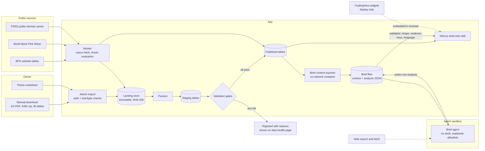

# Architecture (proposed)

**Status:** M1 built 2026-10-22 (import pipeline, data health, ownership section, deploy skeleton). The rest is still the plan. Sigi is a fresh repository; modules are copied from Sunrise using the manifest in §7 (D-011). Module paths refer to the Sunrise codebase (public at github.com/Azzamubaidillah/sunrise). Line counts come from a read-only audit on 2026-10-18.

## 1. Shape

- **One writer:** the worker and the import handler are the only code that writes. The web app reads only, the same rule as Sunrise.
- **Fail-closed publish:** a month's ownership data becomes visible only when every gate passes (PRD F1). A failed import never replaces the last good month.
- **Rebuildable:** published tables can be regenerated from the landing store. CI checks that the regenerated content hashes match (PRD F10).
- **Widgets are outside the data path:** TradingView content renders in the visitor's browser and is never read by our code (D-004).

## 2. Data volume

| Table family | Rows per month | Notes |
|---|---|---|
| Ownership (S1) | ~7,300 | One row per issuer–holder pair |
| KSEI composition (S2) | ~3,750 | One row per security; admin-only until cleared |
| Macro observations | < 1,000 | About 30 series |
| Theses | Tens | Markdown plus typed conditions |

That is tens of thousands of rows a year. **SQLite in WAL mode with Drizzle** (as in Sunrise) is enough for P1. Re-evaluate Postgres at P3, when reader accounts and concurrent writes arrive.

## 3. Sunrise reuse map

| Concern | Sunrise module | Action |
|---|---|---|
| Worker and scheduler | `worker/index.ts`, `src/worker/schedule.ts` (296 lines: in-flight guard, deadlines, backoff, drain on shutdown) | Keep; replace the task list |
| Sync runs and freshness | `sync_runs` table, `src/health-rules.ts` (273), `src/health.ts` (574), the data-health page | Keep; add import-run and gate-result tables |
| Retention | `src/worker/retention.ts` (253) | Keep the policy shape; ownership history is never pruned |
| Auth | `proxy.ts`, `src/security/*`, `app/login` | Keep (single owner in P1). Add the TradingView origins to the CSP |
| Thesis format | `src/views/theses.ts` (589: markdown to a typed block tree, never HTML), `src/thesis-levels.ts` (strict grammar) | Keep the parser. Extend the grammar with typed conditions (ownership, float, macro, date, price as manual check) |
| Macro engine | `src/macro/series.ts`, `src/views/macro-indicators.ts` (183), `app/_sections/Macro.tsx` | Keep the engine and layout. Replace the 17 US/crypto series with the Indonesian registry; replace the "good for crypto" direction with sector links |
| Per-symbol page | `src/views/coin.ts` (873; slices with `source`/`asOf`/`absent` and a closed enum of reasons) | Keep the pattern for the ticker page |
| AI brief channel (P2) | `src/brief/{build,files}.ts`, `src/views/brief.ts` (validate, then require the cited evidence to exist in the context file) | Keep for P2 |
| Design system | `app/sunrise.css`, `app/_components/*`, `Localized` (en/id) | Keep; restyle |
| Money and formatting | `src/money.ts` (exact decimals), `app/_lib/format.ts` | Keep |
| `verify` gate | `package.json` `verify`, `scripts/verify-clean.ts` | Keep |
| Spreadsheet import flow | `app/api/imports/*` | Reuse as the starting point for the admin upload |

**Remove:** every ledger route and view (portfolio, activity, analytics, calendar, journal, risk, wallets, dust, sold, staking, exchange accounts), the accounting and imports logic tied to fills, all exchange and wallet integrations, Hyperliquid and derivatives, and `app/_lib/held-positions.ts` (replaced by a watchlist and coverage loader).

**Assumptions to remove:** a 16:00 UTC daily close (IDX closes at 16:00 WIB, and we store no daily prices anyway), the BTC benchmark, and crypto sectors (replaced by the IDX-IC sector names from our imports and editorial mapping).

## 4. Import pipeline detail

1. **Upload:** owner only; size cap; type check (PDF for S1, ZIP or TXT for S2, CSV/XLSX for macro tables). The admin enters the source URL and access date (needed for citation, S1).
2. **Land:** write the file to the landing store under its SHA-256 and record provenance. Uploading the same hash again is a no-op.
3. **Parse:** a deterministic parser per source and layout version.
   - S1 is an Excel-generated PDF, so extract the text layout with a PDF text library and pin its version.
   - S2 is pipe-delimited text with a fixed header; reject the file if the header doesn't match.
4. **Stage:** typed rows plus the parser version.
5. **Gate:** per-source checks (PRD F1). Results are stored per import.
6. **Publish:** swap staging into the published tables in one transaction, with an audit row.
7. **Rebuild check (CI):** re-run 3–6 from the landing fixtures and compare content hashes.

## 5. Pages (P1)

| Route | Content |
|---|---|
| `/` | Market page: index and sector widgets; ownership screens; investability summary |
| `/investability` | Float tracker, tranche deadlines, MSCI timeline, methodology |
| `/t/[code]` | Ticker page: our slices plus widget slots |
| `/holders/[slug]` | Pages for corporate, fund and institution holders only (D-007) |
| `/macro` | Indonesian macro dashboard with sector links |
| `/theses`, `/theses/[slug]` | Theses, conditions-hit list, version history |
| `/brief` | Today's brief, stale marker, rejected-file notice, inputs table (F12) |
| `/data` | Data health, imports, gate results, sources and licences |
| `/admin/*` | Import and thesis editing (owner only) |

## 6. Testing

- **Unit:** parsers against fixture files (a real-layout sample per source); gate functions; concentration and float maths; thesis condition evaluation.
- **Integration:** the full pipeline from upload through publish and rebuild, against a temporary database.
- **E2E (Playwright):** every public page renders with seeded data; a failing gate shows on `/data` and leaves the previous month published; absent states render.
- **Accessibility:** Lighthouse ≥90 on every page.
- **Licence check:** a build step fails if a page renders a figure whose source ID is missing from the register.
- **Brief validator:** fixture analyses covering each rejection reason (unknown evidence key, wrong date, oversized file, recommendation language, schema violation), plus an acceptance fixture.

## 7. Copy manifest from Sunrise (D-011)

**Source:** the public `sunrise` repository. A file that is newer only in the owner's private working copy may be copied one file at a time, and only after the leak scan below passes on it. Copied tests travel with their module; their bodies are rewritten wherever they encode crypto semantics.

### Copy and adapt

| Area | Sunrise paths | Adaptation for Sigi |
|---|---|---|
| Tooling | `package.json`, `tsconfig.json`, `tsconfig.worker.json`, `next.config.ts`, `eslint.config.mjs`, `postcss.config.mjs`, `vitest.config.ts`, `drizzle.config.ts`, `Dockerfile`, `instrumentation.ts`, `instrumentation-node.ts` | Rename to `sigi`; drop dependencies of the dropped integrations; regenerate the lockfile; keep the `verify` script chain |
| Request boundary and auth | `proxy.ts`, `src/security/{csrf,passcode,public-paths,request,session,throttle,throttle-store}.ts`, `app/login/`, `app/api/auth/` | Add the TradingView origins to the CSP; host-only session cookie; public pages need no session; admin routes do |
| Worker | `worker/index.ts`, `src/worker/{schedule,runtime,retention,alerts}.ts`, `src/sync/{abort,retry,sleep-wake}.ts` | Rewrite the task list (macro fetch, news, thesis evaluation, retention); drop `value-points` and `plan-alerts` |
| Database | `src/db/{client,read,migrate,integrity-thread}.ts` | Write `schema.ts` fresh (infrastructure tables plus Sigi's tables); migrations start at 0000 |
| Health | `src/health-rules.ts`, `src/health.ts`, `src/freshness.ts`, `src/integrity.ts`, `src/views/sync-trends.ts`, `app/(dashboard)/data-health/`, `app/_sections/DataHealth.tsx`, `app/api/{health,freshness}/` | Replace the source list; add import runs, gate results and licence status |
| Backups | `src/backup.ts` | Keep local rotating backups; an offsite target only if it is free |
| Shared utilities | `src/{money,stable-id,pagination,logger,server-timing,config}.ts`, `src/views/table-sort.ts`, `app/_lib/{format,pages}.ts`, `app/_components/Localized.tsx` | Prune `config.ts`; rewrite the navigation in `pages.ts` |
| Theses | `src/views/theses.ts`, `src/{thesis-folder,thesis-visibility,thesis-levels}.ts`, `app/(dashboard)/theses/`, `app/_sections/{Theses,ThesisReader}.tsx`, `scripts/publish-theses.sh` | Extend the levels grammar into typed conditions (PRD F7); remove the quote, holdings and order coupling |
| Macro | `src/macro/{series,files}.ts`, `src/integrations/macro/`, `src/views/{macro,macro-indicators}.ts`, `app/(dashboard)/macro/`, `app/_sections/Macro.tsx` | Indonesian registry from DATA-SOURCES S4, S6, S7 and S8; sector links replace the "good for crypto" direction; drop the regime score and the separate AI macro review (folded into the brief) |
| News | `src/news/feeds.ts`, `src/integrations/news/` | New feed list (S10): headline, publisher, time and link only |
| Brief | `src/brief/{build,files}.ts`, `src/views/brief.ts`, `app/(dashboard)/brief/`, `app/_sections/Brief.tsx`, `app/_components/BriefCard.tsx`, `scripts/brief-context.ts`, `scripts/brief/{brief-run.sh,brief-prompt.md,brief-settings.json}`, `scripts/install-brief-schedule.sh` | §8. Host paths, user names and container names come from configuration, never literals |
| Ticker page pattern | `src/views/coin.ts` (the slice type and its composition only) | Becomes `src/views/ticker.ts` with Sigi's own slices |
| Upload flow | `app/api/imports/` | Becomes the admin upload for S1, S2 and macro tables, feeding the landing store |
| Design system | `app/sunrise.css`, the generic parts of `app/_components/` and `components/` (cards, health badges, ages, drawers, command palette, preferences, refresh, sparkline, series chart), `components/ui/button.tsx` | Rename the stylesheet to `app/sigi.css`; restyle; leave out crypto-specific components such as asset icons and coin parts |
| Verify gate | `scripts/verify-clean.ts` | Keep |

### Copy log

**M1 (2026-10-22), from public `sunrise` at `312906f`.** The leak scan ran before the first commit.

- **Copied, renamed `sunrise` → `sigi`, imports made extensionless:**
  - `src/security/{csrf,passcode,request,session,throttle,throttle-store}.ts`, with the csrf, passcode, request, session, throttle and login-route tests;
  - `src/db/{client,read,migrate}.ts`, with the read and migrate tests (Sunrise's price-index cases removed);
  - `app/api/auth/{csrf,login,logout}/route.ts`;
  - `scripts/{hash-passcode,migrate,verify-clean}.ts`;
  - `tsconfig.json`, `next.config.ts`, `eslint.config.mjs`, `vitest.config.ts`, `drizzle.config.ts`, the Prettier and ignore files.
- **Written fresh instead:**
  - `src/config.ts`: Sunrise's has 478 lines of exchange and wallet settings;
  - `src/logger.ts`: redaction list trimmed;
  - `proxy.ts`: every page public, a session only for `/admin` and `/api/admin`;
  - `src/security/{admin-paths,owner-request}.ts`;
  - `Dockerfile`: builds in the image;
  - `scripts/container-start.sh`.
- **Changed from the manifest:**
  - No Tailwind, and `sunrise.css` (11,132 lines, nearly all for ledger pages) is not copied. `app/sigi.css` keeps Sunrise's colour tokens plus about 400 lines of primitives.
  - `SigiDatabase` is declared as a type rather than `ReturnType<…>`.
  - No `tsconfig.worker.json` and no worker until M3, because M1 has nothing to schedule. Until then, the landing store plus the rebuild check is the recovery path for published data.
  - The data health page in M1 is built from import runs and gate results. Sunrise's sync-run health arrives with the worker.
- **Not yet copied** (their milestones): worker, health rules, backups, theses, macro, news, brief and the design components.

### Never copied

- **Ledger and account features:** portfolio, activity, analytics, calendar, journal, risk, wallets, dust, sold coins, staking, the exchange accounts; `src/{accounting,imports,dust,reconciliation}/`.
- **Crypto data:** `src/{hyperliquid,positioning,events,market,assets}/`; `src/integrations/{aster,bitget,derivatives,evm,jupiter,solana,tokocrypto,market,events,fx}/`; screener, whales, positioning and coin pages; paper trading and backtests.
- **Mobile:** the device pairing and mobile API (`app/api/{mobile,devices}/`, `src/security/{device-credential,device-store,mobile-auth,pairing-throttle-store}.ts`) and the iOS app.
- **Not code:**
  - Sunrise's `docs/` (its decision log is consulted, not copied);
  - agent and assistant files (`AGENTS.md`, `CLAUDE.md`, `.claude/`, `.omp/`, `.mcp.json`, `RTK.md`, `TODO.md`);
  - `data/`, `references/`, `dist-worker/`, `drizzle/` migrations;
  - deployment scripts that carry host details (`scripts/deploy.sh`, the other `install-*-schedule.sh`, backup and `verify-*` host scripts).

### Leak scan (blocks the first commit and every later copy)

- gitleaks over the working tree.
- A pattern scan for:
  - IPv4 addresses;
  - EVM addresses (`0x` followed by 40 hex characters);
  - Solana-style base58 strings of 32–44 characters outside test fixtures;
  - the owner's private domains and private project names;
  - absolute home-directory paths.
- Any hit stops the copy until it is explained or removed.

## 8. Daily brief pipeline (D-012, PRD F12)

It works the same way as Sunrise's brief, with the public-site changes marked **Sigi**.

1. **Schedule:** a host cron entry runs the runner every hour. The runner acts only in its configured UTC hour; 23:00 UTC is 06:00 WIB, before the 09:00 WIB market open. A lock file prevents overlapping runs. The log is size-capped. If the agent credential is missing, the run is skipped and the skip is logged.
2. **Export:**
   - `scripts/brief-context.ts` runs in a throwaway container of the deployed worker image, with **no network** and read-only access to the database.
   - It writes `brief/context/<date>.json`: every reading with `asOf`, `source`, evidence status and a `key` per citable item (e.g. `own:<CODE>:<YYYY-MM>`, `float:<CODE>`, `macro:<series>:<date>`, `thesis:<slug>`, `event:<id>`), plus an `absent` list.
   - **Sigi:** individual holders are excluded at export time.
3. **Agent:**
   - The coding agent runs headless as an unprivileged user.
   - It may read: the context, yesterday's analysis, the theses.
   - It may use web search and fetch.
   - It may write: only `brief/analysis/<date>.json`.
   - It is denied: the shell, the database, the env files, the home directories, and edits anywhere else.
   - The prompt is a versioned file in the repo.
   - **Sigi:** the prompt states the public-site rules (no advice, no prices, targets or sizes, links rather than quotes, no individuals).
4. **Validate (web):**
   - A Zod schema checks the analysis.
   - Its date must match the file name, and its `contextGeneratedAt` must match the context file.
   - Every evidence key must exist in that context.
   - The size cap applies.
   - **Sigi:** a recommendation-language check runs, with a documented word list and its stated limits.
   - The newest valid analysis is shown. A newer invalid file is named, with its reasons. A brief older than 30 h is marked stale.
5. **Unpublish:** the owner can hide a brief from the admin page, and the page records the reason. This is the manual backstop for PRD R9.
