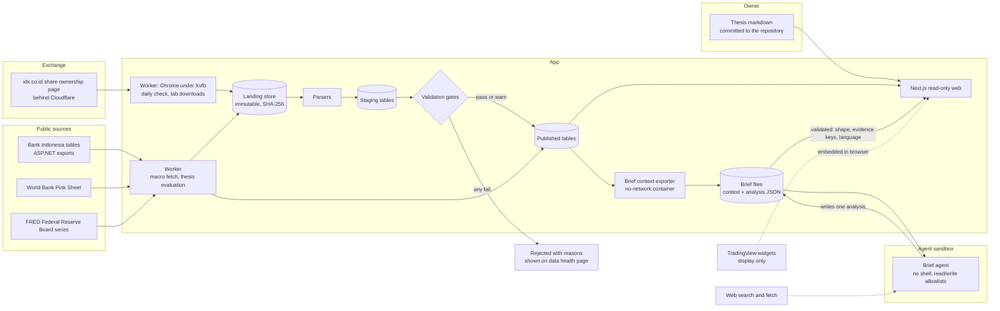

# Architecture (proposed)

**Status:** M1 (import pipeline, data health, ownership section, deployment) and M2 (investability tracker, holder explorer, market page) are built; production runs on Dokploy (D-020). Since 2026-10-24 a worker fetches the monthly holder files and the macro series and nothing is uploaded; the admin area is gone (D-021). M3 (macro dashboard) is built (D-023), and so are M4 (theses with conditions the worker checks daily, D-024), M5 (the daily brief, D-025) and M6 (ticker page, English and Indonesian, Playwright and Lighthouse, D-026). The one step left is the public launch, which is the owner's call. Sigi is a fresh repository; modules are copied from Sunrise using the manifest in §7 (D-011). Module paths refer to the Sunrise codebase (public at github.com/Azzamubaidillah/sunrise). Line counts come from a read-only audit on 2026-10-18.

## 1. Shape

- **One writer:** the worker is the only code that writes data; the web container only migrates the schema at start. The web app reads only and answers GET and HEAD only, the same rule as Sunrise, with no sign-in.
- **Fail-closed publish, no human step:** a month's ownership data becomes visible only when no gate fails; warnings publish and are shown (PRD F1). A failed import never replaces the last good month.
- **Rebuildable:** published tables can be regenerated from the landing store. CI checks that the regenerated content hashes match (PRD F10).
- **Widgets are outside the data path:** TradingView content renders in the visitor's browser and is never read by our code (D-004).

## 2. Data volume

| Table family | Rows per month | Notes |
|---|---|---|
| Ownership (S1) | ~7,200 | One row per issuer–holder pair |
| KSEI composition (S2) | ~3,750 | One row per security; not fetched until cleared |
| Macro observations | ~8,000 stored | 13 series, each replaced whole by its latest file (daily series hold three years, monthly ones from 2016, the Pink Sheet from 1960) |
| Theses | Tens | Markdown plus typed conditions |

That is tens of thousands of rows a year. **SQLite in WAL mode with Drizzle** (as in Sunrise) is enough for P1. Re-evaluate Postgres at P3, when reader accounts and concurrent writes arrive.

## 3. Sunrise reuse map

| Concern | Sunrise module | Action |
|---|---|---|
| Worker and scheduler | `worker/index.ts`, `src/worker/schedule.ts` (296 lines: in-flight guard, deadlines, backoff, drain on shutdown) | Keep; replace the task list |
| Sync runs and freshness | `sync_runs` table, `src/health-rules.ts` (273), `src/health.ts` (574), the data-health page | Keep; add import-run and gate-result tables |
| Retention | `src/worker/retention.ts` (253) | Keep the policy shape; ownership history is never pruned |
| Request boundary | `proxy.ts`, `src/security/request.ts` | Keep the host boundary and CSP, with the TradingView origins. (The sign-in copied in M1 was removed in D-021) |
| Thesis format | `src/views/theses.ts` (589: markdown to a typed block tree, never HTML), `src/thesis-levels.ts` (strict grammar) | Keep the parser. Extend the grammar with typed conditions (ownership, float, macro, date, price as manual check) |
| Macro engine | `src/macro/series.ts`, `src/views/macro-indicators.ts` (183), `app/_sections/Macro.tsx` | Keep the engine and layout. Replace the 17 US/crypto series with the Indonesian registry; replace the "good for crypto" direction with sector links |
| Per-symbol page | `src/views/coin.ts` (873; slices with `source`/`asOf`/`absent` and a closed enum of reasons) | Keep the pattern for the ticker page |
| AI brief channel (P2) | `src/brief/{build,files}.ts`, `src/views/brief.ts` (validate, then require the cited evidence to exist in the context file) | Keep for P2 |
| Design system | `app/sunrise.css`, `app/_components/*`, `Localized` (en/id) | Keep; restyle |
| Money and formatting | `src/money.ts` (exact decimals), `app/_lib/format.ts` | Keep |
| `verify` gate | `package.json` `verify`, `scripts/verify-clean.ts` | Keep |
| Spreadsheet reader | `src/imports/xlsx.ts` | Reads the S1 workbook (D-022) |

**Remove:** every ledger route and view (portfolio, activity, analytics, calendar, journal, risk, wallets, dust, sold, staking, exchange accounts), the accounting and imports logic tied to fills, all exchange and wallet integrations, Hyperliquid and derivatives, and `app/_lib/held-positions.ts` (replaced by a watchlist and coverage loader).

**Assumptions to remove:** a 16:00 UTC daily close (IDX closes at 16:00 WIB, and we store no daily prices anyway), the BTC benchmark, and crypto sectors (replaced by the IDX-IC sector names from our imports and editorial mapping).

## 4. Import pipeline detail

1. **Fetch (worker, daily):** open the exchange's share-ownership data page in Google Chrome under Xvfb, with the puppeteer stealth evasions; click the Cloudflare checkbox if one shows. Read the file list from `window.__NUXT__` and keep the monthly *Pemegang Saham di Atas 1%* workbooks on the exchange's `/Media/` store. Each one not yet imported by the current parser version is opened in a tab and taken from Chrome's downloads (an in-page fetch of the file store gets a challenge or a cut-off body), size-capped and checked to be a complete ZIP. Months go oldest first; the first error ends the run. Every run is a `fetch_runs` row (D-021).
2. **Land:** write the file to the landing store under its SHA-256 and record provenance: the exchange's URL and the Jakarta access date, for the citation. The same hash again is a no-op.
3. **Parse:** a deterministic parser per source and layout version.
   - S1 is an XLSX workbook; the header row and its twelve columns are checked (D-022).
   - S2 is pipe-delimited text with a fixed header; reject the file if the header doesn't match.
4. **Stage:** typed rows plus the parser version.
5. **Gate:** per-source checks (PRD F1), each pass, warn or fail. Results are stored per import.
6. **Publish:** unless a gate failed, swap staging into the published tables in one transaction, with an audit row. A re-issued month (a published record date under a new URL) replaces the old one.
7. **Rebuild check (CI):** re-run 3–6 from the landing fixtures and compare content hashes.

**Macro feeds (D-023):** eight files a day over plain HTTP, defined in `src/macro/feeds.ts` with the series registry in `src/macro/series.ts`: four Bank Indonesia exports (the ASP.NET form posted back with a date range and its export button), the World Bank's monthly workbook (found by its link on the commodity-markets page) and three FRED CSVs. Each is parsed (`src/macro/parse.ts`), gated and, unless a gate fails, replaces its series whole (`src/macro/import.ts`); a file whose figures equal what is published is a no-op. Nothing derived is stored: changes and year-on-year moves are computed by the view (`src/views/macro.ts`).

**Processes:** `sigi-web` (Next.js; migrates at start) and `sigi-worker` (`scripts/worker.ts`; waits until the schema is current, so only one process migrates). The schedule lives in `fetch_runs`: the next check is due one interval after the last finished run, three hours after a failed one, so restarts neither skip nor repeat checks. Chrome runs with `--no-sandbox` because the container has no user namespaces; it only visits idx.co.id.

## 5. Pages (P1)

| Route | Content |
|---|---|
| `/` | Market page: IHSG chart and IDX screener (TradingView widgets); the ownership screen with URL filters (built, M2) |
| `/investability` | Sigi's count against the exchange's, bands of the float bound, companies certainly below 15% with possible deadlines, timeline, methodology (built, M2) |
| `/t/[code]` | Ticker page: free-float bound and rule status, holders, month-over-month changes, rule and index dates, theses naming the code, then apart and labelled "Data by TradingView" the chart, fundamentals, profile and top stories (built, M2 and M6) |
| `/holders`, `/holders/[slug]` | Pages for corporate, fund and institution holders only (D-007, D-018; built, M2) |
| `/privacy` | What the site and the TradingView widgets receive (built, M2) |
| `/macro` | Macro dashboard: a card per series with published and derived values, a year's chart, source, release dates and sector links; IDX sector indices beside each group (built, M3) |
| `/theses`, `/theses/[slug]` | Theses, conditions-hit list, version history (built, M4) |
| `/brief` | Today's brief, stale marker, rejected-file notice, inputs table (built, M5; F12) |
| `/data` | Data health: the worker's checks, imports, gate results with warnings, sources and licences |
| `/lang` | Sets the language cookie and redirects back (GET only; built, M6, D-026) |
| `/robots.txt`, `/sitemap.xml` | Crawler rules and the page list (built, M6) |

## 6. Testing

- **Unit:** parsers against fixture files (a real-layout sample per source); gate functions; concentration and float maths; thesis condition evaluation.
- **Integration:** the full pipeline from a fetch run (with a stand-in for the exchange's page) through publish and rebuild, against a temporary database. The browser itself is exercised by running the worker once (`--once`), not in CI.
- **E2E (Playwright):** every public page renders with seeded data; a failing gate shows on `/data` and leaves the previous month published; absent states render.
- **Accessibility:** Lighthouse ≥90 on every page.
- **Licence check:** a build step fails if a page renders a figure whose source ID is missing from the register.
- **Brief validator:** fixture analyses covering each rejection reason (unknown evidence key, wrong date, oversized file, recommendation language, schema violation), plus an acceptance fixture.

## 7. Copy manifest from Sunrise (D-011)

**Source:** the public `sunrise` repository. A file that is newer only in the owner's private working copy may be copied one file at a time, and only after the leak scan below passes on it. Copied tests travel with their module; their bodies are rewritten wherever they encode crypto semantics.

### Copy and adapt

| Area | Sunrise paths | Adaptation for Sigi |
|---|---|---|
| Tooling | `package.json`, `tsconfig.json`, `tsconfig.worker.json`, `next.config.ts`, `eslint.config.mjs`, `postcss.config.mjs`, `vitest.config.ts`, `drizzle.config.ts`, `Dockerfile`, `instrumentation.ts`, `instrumentation-node.ts` | Rename to `sigi`; drop dependencies of the dropped integrations; regenerate the lockfile; keep the `verify` script chain |
| Request boundary and auth | `proxy.ts`, `src/security/{csrf,passcode,public-paths,request,session,throttle,throttle-store}.ts`, `app/login/`, `app/api/auth/` | Add the TradingView origins to the CSP. *(The sign-in half was copied in M1 and removed on 2026-10-24, D-021; the request boundary stays.)* |
| Worker | `worker/index.ts`, `src/worker/{schedule,runtime,retention,alerts}.ts`, `src/sync/{abort,retry,sleep-wake}.ts` | Rewrite the task list (macro fetch, news, thesis evaluation, retention); drop `value-points` and `plan-alerts` |
| Database | `src/db/{client,read,migrate,integrity-thread}.ts` | Write `schema.ts` fresh (infrastructure tables plus Sigi's tables); migrations start at 0000 |
| Health | `src/health-rules.ts`, `src/health.ts`, `src/freshness.ts`, `src/integrity.ts`, `src/views/sync-trends.ts`, `app/(dashboard)/data-health/`, `app/_sections/DataHealth.tsx`, `app/api/{health,freshness}/` | Replace the source list; add import runs, gate results and licence status |
| Backups | `src/backup.ts` | Keep local rotating backups; an offsite target only if it is free |
| Shared utilities | `src/{money,stable-id,pagination,logger,server-timing,config}.ts`, `src/views/table-sort.ts`, `app/_lib/{format,pages}.ts`, `app/_components/Localized.tsx` | Prune `config.ts`; rewrite the navigation in `pages.ts` |
| Theses | `src/views/theses.ts`, `src/{thesis-folder,thesis-visibility,thesis-levels}.ts`, `app/(dashboard)/theses/`, `app/_sections/{Theses,ThesisReader}.tsx`, `scripts/publish-theses.sh` | Extend the levels grammar into typed conditions (PRD F7); remove the quote, holdings and order coupling |
| Macro | `src/macro/{series,files}.ts`, `src/integrations/macro/`, `src/views/{macro,macro-indicators}.ts`, `app/(dashboard)/macro/`, `app/_sections/Macro.tsx` | Indonesian registry from DATA-SOURCES S4, S6, S7 and S8; sector links replace the "good for crypto" direction; drop the regime score and the separate AI macro review (folded into the brief) |
| News | `src/news/feeds.ts`, `src/integrations/news/` | New feed list (S10): headline, publisher, time and link only |
| Brief | `src/brief/{build,files}.ts`, `src/views/brief.ts`, `app/(dashboard)/brief/`, `app/_sections/Brief.tsx`, `app/_components/BriefCard.tsx`, `scripts/brief-context.ts`, `scripts/brief/{brief-run.sh,brief-prompt.md,brief-settings.json}`, `scripts/install-brief-schedule.sh` | §8. Host paths, user names and container names come from configuration, never literals |
| Ticker page pattern | `src/views/coin.ts` (the slice type and its composition only) | Becomes `src/views/ticker.ts` with Sigi's own slices |
| Upload flow | `app/api/imports/` | *Not copied: there are no uploads (D-021). The worker feeds the landing store.* |
| Design system | `app/sunrise.css`, the generic parts of `app/_components/` and `components/` (cards, health badges, ages, drawers, command palette, preferences, refresh, sparkline, series chart), `components/ui/button.tsx` | Rename the stylesheet to `app/sigi.css`; restyle; leave out crypto-specific components such as asset icons and coin parts |
| Verify gate | `scripts/verify-clean.ts` | Keep |

### Copy log

**M1 (2026-10-22), from public `sunrise` at `312906f`.** The leak scan ran before the first commit.

- **Copied, renamed `sunrise` → `sigi`, imports made extensionless:**
  - `src/security/{csrf,passcode,request,session,throttle,throttle-store}.ts`, with the csrf, passcode, request, session, throttle and login-route tests;
  - `src/db/{client,read,migrate}.ts`, with the read and migrate tests (Sunrise's price-index cases removed);
  - `app/api/auth/{csrf,login,logout}/route.ts`;
  - `scripts/{hash-passcode,migrate,verify-clean}.ts`;
  - `tsconfig.json`, `next.config.ts`, `eslint.config.mjs`, `vitest.config.ts`, `drizzle.config.ts`, the Prettier and ignore files.
- **Written fresh instead:**
  - `src/config.ts`: Sunrise's has 478 lines of exchange and wallet settings;
  - `src/logger.ts`: redaction list trimmed;
  - `proxy.ts`: every page public, a session only for `/admin` and `/api/admin`;
  - `src/security/{admin-paths,owner-request}.ts`;
  - `Dockerfile`: builds in the image;
  - `scripts/container-start.sh`.
- **Changed from the manifest:**
  - No Tailwind, and `sunrise.css` (11,132 lines, nearly all for ledger pages) is not copied. `app/sigi.css` keeps Sunrise's colour tokens plus about 400 lines of primitives.
  - `SigiDatabase` is declared as a type rather than `ReturnType<…>`.
  - No `tsconfig.worker.json`: the worker (added 2026-10-24, D-021) runs through tsx like the other scripts. The landing store plus the rebuild check is the recovery path for published data.
  - The data health page is built from fetch runs, import runs and gate results, not Sunrise's sync-run health rules.
- **Not yet copied** (their milestones): health rules, backups, theses, macro, news, brief and the design components.

**Automation (2026-10-24), from public `sunrise` at `312906f`.** The leak scan ran before the commit.

- **Copied:** `src/imports/xlsx.ts` with its test. Changed: relationship targets resolve relative to `xl/`; a self-closing cell no longer swallows the next one; a null sheet name reads the only sheet; the resolved sheet name is returned.
- **Removed (D-021):** everything sign-in: `src/security/{csrf,passcode,session,throttle,throttle-store,admin-paths,owner-request}.ts` and their tests, `app/api/auth/`, `app/login/`, `app/admin/`, `app/api/admin/`, `scripts/hash-passcode.ts`, the `login_attempts` table.
- **Written fresh:** the worker (`scripts/worker.ts`, `src/fetch/`). Sunrise's scheduler is not copied: one daily task needs a loop and a `fetch_runs` row, not deadlines and backoff.

**Theses (2026-10-25, M4), from public `sunrise` at `312906f`.** The leak scan ran before the commit.

- **Copied:** the markdown-to-block-tree conversion of `src/views/theses.ts` (into `src/theses/markdown.ts`) and the renderer of `app/_components/ThesisBody.tsx`. Changed: links to other theses point to `/theses/<slug>?version=`, and site paths such as `/t/BBRI` are kept. The folds, the contents and the price quotes are not copied.
- **Written fresh, after Sunrise's pattern:** the strict `thesis` and `conditions` fence grammars, in the manner of `src/thesis-levels.ts` (`src/theses/{header,conditions}.ts`); the folder reader with dated version files (`src/theses/folder.ts`, after `src/thesis-folder.ts`); the line diff; the daily check in the worker (`src/theses/check.ts`); and the pages `/theses` and `/theses/[slug]` (D-024).
- **Not copied:** hidden theses, plan levels, held positions, quote windows and the publish script. Theses ship with a deploy, not a mirror.

**Daily brief (2026-10-25, M5), from public `sunrise` at `312906f`.** The leak scan ran before the commit.

- **Followed, written fresh:** the two-file design of `src/brief/files.ts` (a strict context schema with an evidence key per item, a strict analysis schema, `contextKeys`, `unknownEvidenceKeys`); the selection logic of `src/views/brief.ts` (newest file that validates, a rejected newer file named, stale after 30 h); `scripts/brief/brief-run.sh` (hourly cron, a lock, a no-network export container, the agent as an unprivileged user in `--restricted` mode with allowlists) and `brief-settings.json`.
- **Changed for a public site:** the analysis answers "what to look at", not "what to do" (no actions, no stance `act`); the recommendation check; the Jakarta date; the host directory outside `/opt/sigi`; the context holds Sigi's readings, not a portfolio's. The amount and address leak checks, the portfolio sections and `brief-context.ts` of Sunrise are not copied.
- **Not copied:** the brief card on a dashboard, and the macro review that feeds Sunrise's brief.

### Never copied

- **Ledger and account features:** portfolio, activity, analytics, calendar, journal, risk, wallets, dust, sold coins, staking, the exchange accounts; `src/{accounting,imports,dust,reconciliation}/`.
- **Crypto data:** `src/{hyperliquid,positioning,events,market,assets}/`; `src/integrations/{aster,bitget,derivatives,evm,jupiter,solana,tokocrypto,market,events,fx}/`; screener, whales, positioning and coin pages; paper trading and backtests.
- **Mobile:** the device pairing and mobile API (`app/api/{mobile,devices}/`, `src/security/{device-credential,device-store,mobile-auth,pairing-throttle-store}.ts`) and the iOS app.
- **Not code:**
  - Sunrise's `docs/` (its decision log is consulted, not copied);
  - agent and assistant files (`AGENTS.md`, `CLAUDE.md`, `.claude/`, `.omp/`, `.mcp.json`, `RTK.md`, `TODO.md`);
  - `data/`, `references/`, `dist-worker/`, `drizzle/` migrations;
  - deployment scripts that carry host details (`scripts/deploy.sh`, the other `install-*-schedule.sh`, backup and `verify-*` host scripts).

### Leak scan (blocks the first commit and every later copy)

- gitleaks over the working tree.
- A pattern scan for:
  - IPv4 addresses;
  - EVM addresses (`0x` followed by 40 hex characters);
  - Solana-style base58 strings of 32–44 characters outside test fixtures;
  - the owner's private domains and private project names;
  - absolute home-directory paths.
- Any hit stops the copy until it is explained or removed.

## 8. Daily brief pipeline (D-012, D-025, PRD F12)

It works the same way as Sunrise's brief, with the public-site changes marked **Sigi**. Built in M5.

1. **Schedule:** `scripts/install-brief-schedule.sh` puts one host cron line, hourly at :10, that runs `/opt/sigi-brief/brief-run.sh`. The runner acts only in the 06:00 hour in Jakarta (`TZ=Asia/Jakarta`, so the host's own zone does not matter), before the 09:00 WIB market open. A lock file prevents overlapping runs. The log is size-capped. If the agent credential is missing, the run is skipped and the skip is logged. **Sigi:** the run's date is the Jakarta date, and it is the analysis file's name and the context's `today`.
2. **Export:**
   - `scripts/brief-context.ts` runs in a throwaway container of the deployed worker image, with **no network** and the data directory mounted read-only.
   - It writes `context/<date>.json`: every reading with `asOf`, `source`, evidence status and a `key` per citable item (`own:<CODE>`, `float:<CODE>`, `macro:<series>:<period>`, `cond:<thesis>:<n>`, `event:<date>:<n>`, `health:<feed>`, `news:<id>`), plus an `absent` list. It validates its own output before printing.
   - **Sigi:** individual holders from the register are never in the context: only holders that may have a page (institutions, C6) are named, and the rest of the moves are counted. Headlines and theses are text from other sources and are not scrubbed; the prompt tells the agent to leave out personal names.
   - The theses are files in the image, so the runner copies them out to `theses/` for the agent each day.
3. **Agent:**
   - The coding agent runs headless as the unprivileged user `sunrise-agent` (the user and subscription Sunrise's brief uses), with `--restricted` (no shell).
   - It may read: the context, yesterday's analysis, the theses.
   - It may use web search and fetch.
   - It may write: only `analysis/<date>.json`.
   - It is denied: the shell, `/opt/sigi` (the database, the landing store, the env file), the home directories, Sunrise's directory, and edits anywhere else.
   - The prompt is a versioned file in the repo.
   - **Sigi:** the prompt states the public-site rules (no advice, no prices, targets or sizes, links rather than quotes, no individuals).
4. **Where the files live:** `/opt/sigi-brief/{context,analysis,theses,logs}` on the host, outside `/opt/sigi` (mode 700), so the agent cannot reach the database. The web container sees the first three at `/opt/sigi/data/brief` through one bind mount, set once in Dokploy.
5. **Validate (web):**
   - A Zod schema checks the analysis: strict objects, so an extra field such as a target price is refused; stance, headline, "look at" items, changes, risks, set-aside and sources, each with length caps.
   - Its date must match the file name and its context's `today`, and its `contextGeneratedAt` must match the context file.
   - Every evidence key must exist in that context.
   - The size cap applies (512 KiB).
   - **Sigi:** a recommendation-language check runs on every text field (`src/safety/recommendation.ts`: ratings, targets and a sentence opening with buy, sell or hold, in English and Indonesian). Its limit: it is a word list, so it catches wording, not meaning; the prompt and the not-advice notice carry the rest.
   - The newest valid analysis is shown. A newer invalid file is named, with its reason. A brief older than 30 h is marked stale.
   - The validator cannot check that a figure not in the context has a source, or that no article text was quoted; the prompt requires both.
6. **Unpublish:** the owner can hide a brief with a commit and deploy (there is no admin page): add its date and a reason to `src/brief/unpublished.ts`, and the page shows the reason in its place. This is the manual backstop for PRD R9.
