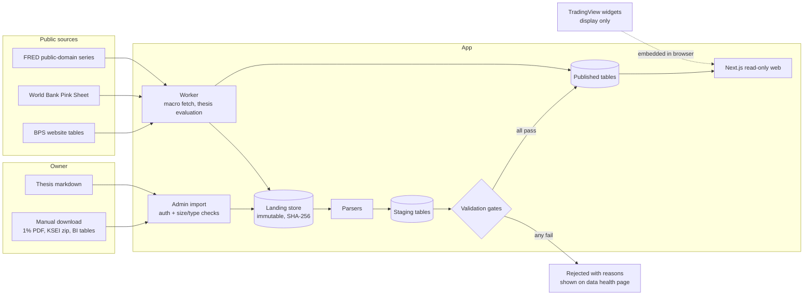

# Architecture (proposed)

**Status:** proposal for P1. Nothing has been built. The module references point to the public `sunrise` repository (github.com/Azzamubaidillah/sunrise). Line counts come from a read-only audit on 2026-10-18.

## 1. Shape

- **One writer:** the worker and the import handler are the only code that writes. The web app reads only, the same rule as Sunrise.
- **Fail-closed publish:** a month's ownership data becomes visible only when every gate passes (PRD F1). A failed import never replaces the last good month.
- **Rebuildable:** published tables can be regenerated from the landing store. CI checks that the regenerated content hashes match (PRD F10).
- **Widgets are outside the data path:** TradingView content renders in the visitor's browser and is never read by our code (D-004).

## 2. Data volume

| Table family | Rows per month | Notes |
|---|---|---|
| Ownership (S1) | ~7,300 | One row per issuer–holder pair |
| KSEI composition (S2) | ~3,750 | One row per security; admin-only until cleared |
| Macro observations | < 1,000 | About 30 series |
| Theses | Tens | Markdown plus typed conditions |

That is tens of thousands of rows a year. **SQLite in WAL mode with Drizzle** (as in Sunrise) is enough for P1. Re-evaluate Postgres at P3, when reader accounts and concurrent writes arrive.

## 3. Sunrise reuse map

| Concern | Sunrise module | Action |
|---|---|---|
| Worker and scheduler | `worker/index.ts`, `src/worker/schedule.ts` (296 lines: in-flight guard, deadlines, backoff, drain on shutdown) | Keep; replace the task list |
| Sync runs and freshness | `sync_runs` table, `src/health-rules.ts` (273), `src/health.ts` (574), the data-health page | Keep; add import-run and gate-result tables |
| Retention | `src/worker/retention.ts` (253) | Keep the policy shape; ownership history is never pruned |
| Auth | `proxy.ts`, `src/security/*`, `app/login` | Keep (single owner in P1). Add the TradingView origins to the CSP |
| Thesis format | `src/views/theses.ts` (589: markdown to a typed block tree, never HTML), `src/thesis-levels.ts` (strict grammar) | Keep the parser. Extend the grammar with typed conditions (ownership, float, macro, date, price as manual check) |
| Macro engine | `src/macro/series.ts`, `src/views/macro-indicators.ts` (183), `app/_sections/Macro.tsx` | Keep the engine and layout. Replace the 17 US/crypto series with the Indonesian registry; replace the "good for crypto" direction with sector links |
| Per-symbol page | `src/views/coin.ts` (873; slices with `source`/`asOf`/`absent` and a closed enum of reasons) | Keep the pattern for the ticker page |
| AI brief channel (P2) | `src/brief/{build,files}.ts`, `src/views/brief.ts` (validate, then require the cited evidence to exist in the context file) | Keep for P2 |
| Design system | `app/sunrise.css`, `app/_components/*`, `Localized` (en/id) | Keep; restyle |
| Money and formatting | `src/money.ts` (exact decimals), `app/_lib/format.ts` | Keep |
| `verify` gate | `package.json` `verify`, `scripts/verify-clean.ts` | Keep |
| Spreadsheet import flow | `app/api/imports/*` | Reuse as the starting point for the admin upload |

**Remove:** every ledger route and view (portfolio, activity, analytics, calendar, journal, risk, wallets, dust, sold, staking, exchange accounts), the accounting and imports logic tied to fills, all exchange and wallet integrations, Hyperliquid and derivatives, and `app/_lib/held-positions.ts` (replaced by a watchlist and coverage loader).

**Assumptions to remove:** a 16:00 UTC daily close (IDX closes at 16:00 WIB, and we store no daily prices anyway), the BTC benchmark, and crypto sectors (replaced by the IDX-IC sector names from our imports and editorial mapping).

## 4. Import pipeline detail

1. **Upload:** owner only; size cap; type check (PDF for S1, ZIP or TXT for S2, CSV/XLSX for macro tables). The admin enters the source URL and access date (needed for citation, S1).
2. **Land:** write the file to the landing store under its SHA-256 and record provenance. Uploading the same hash again is a no-op.
3. **Parse:** a deterministic parser per source and layout version.
   - S1 is an Excel-generated PDF, so extract the text layout with a PDF text library and pin its version.
   - S2 is pipe-delimited text with a fixed header; reject the file if the header doesn't match.
4. **Stage:** typed rows plus the parser version.
5. **Gate:** per-source checks (PRD F1). Results are stored per import.
6. **Publish:** swap staging into the published tables in one transaction, with an audit row.
7. **Rebuild check (CI):** re-run 3–6 from the landing fixtures and compare content hashes.

## 5. Pages (P1)

| Route | Content |
|---|---|
| `/` | Market page: index and sector widgets; ownership screens; investability summary |
| `/investability` | Float tracker, tranche deadlines, MSCI timeline, methodology |
| `/t/[code]` | Ticker page: our slices plus widget slots |
| `/holders/[slug]` | Pages for corporate, fund and institution holders only (D-007) |
| `/macro` | Indonesian macro dashboard with sector links |
| `/theses`, `/theses/[slug]` | Theses, conditions-hit list, version history |
| `/data` | Data health, imports, gate results, sources and licences |
| `/admin/*` | Import and thesis editing (owner only) |

## 6. Testing

- **Unit:** parsers against fixture files (a real-layout sample per source); gate functions; concentration and float maths; thesis condition evaluation.
- **Integration:** the full pipeline from upload through publish and rebuild, against a temporary database.
- **E2E (Playwright):** every public page renders with seeded data; a failing gate shows on `/data` and leaves the previous month published; absent states render.
- **Accessibility:** Lighthouse ≥90 on every page.
- **Licence check:** a build step fails if a page renders a figure whose source ID is missing from the register.
